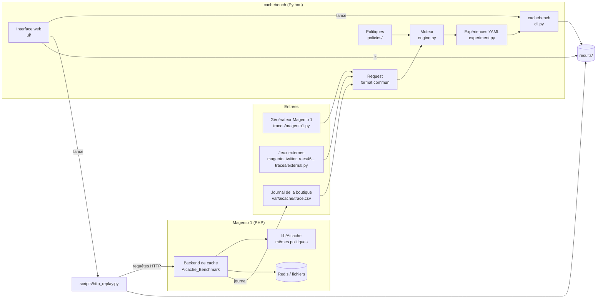
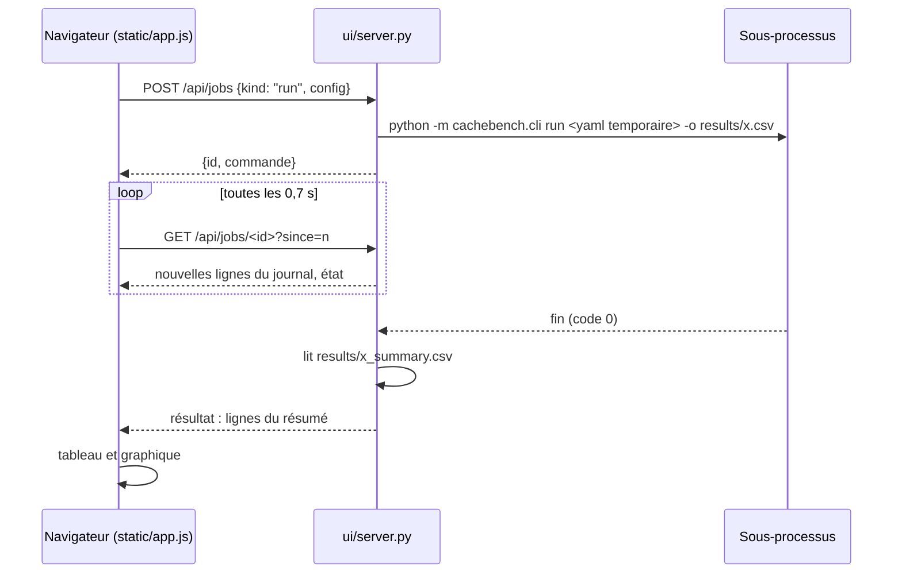
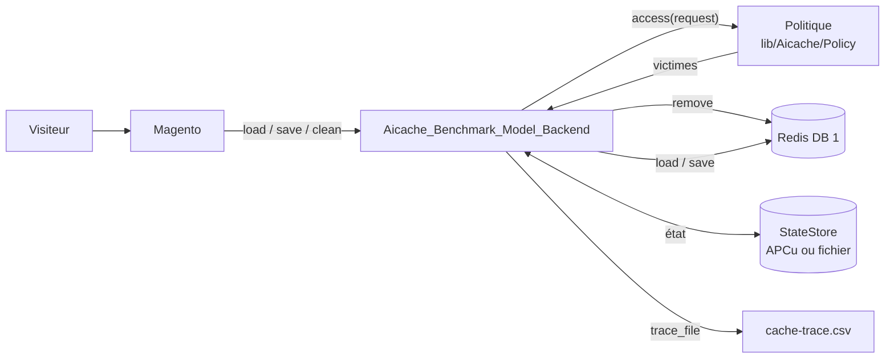

# Architecture — Benchmark de cache IA pour Magento

Le projet compare des algorithmes de cache (classiques, issus de la recherche, appris) sur
du trafic Magento 1, de deux façons :

1. **hors ligne**, en Python : on rejoue une trace de requêtes dans un cache simulé et on
   mesure hit rate, latence simulée et coût de décision ;
2. **en conditions réelles**, en PHP : la même politique décide des évictions du cache de
   Magento, et on mesure les temps des pages servies par la boutique.

Les deux côtés partagent un format de trace et donnent les mêmes décisions, vérifiées
requête par requête par les tests de conformité.

## Vue d'ensemble

## Couches

### Traces (`cachebench/traces/`)

Tout devient une suite de `Request` (`request.py`) : `ts, op, key, size, cost_ms, kind,
cacheable, tags, text`. C'est aussi le format CSV écrit et lu par le module PHP (`io.py`).

| Source | Module | Remarques |
| --- | --- | --- |
| Synthétique Magento 1 | `magento1.py` | sessions sur une chaîne de Markov de routes, popularité Zipf, purges par tags ; une trace par graine |
| Fichiers externes | `external.py` | formats du projet cache_benchmark, lus par son `loaders.py` non modifié (`_cache_benchmark/`) ; format détecté ou forcé |
| Boutique réelle | module PHP | chaque page servie avec son vrai temps de rendu |

### Politiques (`cachebench/policies/`)

Un registre (`@register("nom")`) associe un nom à une classe. Deux contrats :

- `KeyedPolicy` : le stockage, les tags et la capacité sont gérés ; une politique ne choisit
  que la victime (`lru`, `lfu`, `fifo`, `opt`, `drl`, `semantic`) ;
- `CachePolicy` : la politique gère elle-même son stockage. Sert à envelopper du code tiers
  **sans le modifier** : `official.py` (sylab/cacheus : `cacheus`, `lecar`, `arc`, `lirs`)
  et `cacheus_pp.py` (CACHEUS++ du projet cache_benchmark). `cacheus_pp2.py` en dérive
  (CACHEUS++ v2) : chaque correction a son paramètre, et réglé comme l'original il rend les
  mêmes décisions.

`ml/mlp.py` porte le petit réseau numpy de `drl`, exporté en JSON dans `models/` pour que
PHP l'évalue sans dépendance. Son entraînement peut passer sur une carte NVIDIA
(`train-drl --device gpu`) : `ml/device.py` fournit numpy ou CuPy, qui a la même API, et les
poids sont ramenés en numpy avant l'export. Seul l'entraînement change de matériel ; la
collecte des exemples et l'inférence restent sur le processeur.

### Moteur et expériences

- `engine.py` : `simulate(policy, trace, EngineConfig)` joue la trace, exclut la chauffe,
  vérifie après chaque requête que la capacité n'est pas dépassée, et renvoie hit rate,
  byte hit rate, latences simulées (moyenne, p50, p95, p99), surcoût de décision et
  évictions. `sizes` (octets ou unités) et `invalidation` (eager ou lazy) rendent
  comparables des politiques qui n'ont pas les mêmes capacités.
- `experiment.py` : une expérience YAML croise traces × graines × tailles de cache ×
  politiques, écrit une ligne par simulation (`results/<nom>.csv`) et un résumé moyenne ±
  écart-type sur les graines (`results/<nom>_summary.csv`).

### Accès : ligne de commande et interface web

`cli.py` expose `run`, `gen-trace`, `train-drl`, `stats`, `convert`, `list` et `ui`.

`ui/` est une couche mince au-dessus de la ligne de commande :

- **Serveur** (`server.py`) : `ThreadingHTTPServer` de la bibliothèque standard, sur
  127.0.0.1 uniquement. Une tâche = un sous-processus (`cachebench …` ou
  `scripts/http_replay.py`) dont la sortie est gardée en mémoire ; l'annuler arrête le
  processus. À la fin, le serveur lit le fichier produit (résumé CSV, JSON de statistiques,
  CSV des temps HTTP) et le renvoie à la page.
- **API** : `GET /api/info` (politiques, formats, expériences, fichiers de traces),
  `/api/experiment`, `/api/results`, `/api/result`, `/api/magento` (lecture de
  `local.xml`), `/api/jobs[/<id>]` ; `POST /api/jobs`, `/api/jobs/<id>/cancel`,
  `/api/yaml`, `/api/parse`, `/api/experiment/save`.
- **Pourquoi ce choix** : voir [ADR-0001](adr/0001-interface-web.md) (bibliothèque standard
  et sous-processus plutôt que Streamlit, React ou Tkinter).
- **Page** (`static/`) : HTML, CSS et JavaScript sans bibliothèque ni étape de
  construction ; graphiques en SVG ; thème clair et sombre.
- **Sécurité** : POST en JSON uniquement (un autre site ouvert dans le navigateur ne peut pas
  l'envoyer sans requête préalable, que le serveur refuse), en-tête `Host` limité à
  127.0.0.1 / localhost (contre le rebinding DNS), fichiers écrits limités au dossier du
  projet.

### Module PHP pour Magento 1 (`php/`)

Même arborescence que Magento : on copie `lib/`, `app/` et `shell/`.

- `lib/Aicache/` : portage des politiques, avec les mêmes générateurs aléatoires que Python
  (MT19937 pour cacheus, PCG64 de `numpy.random.default_rng` pour CACHEUS++) et les mêmes
  calculs dans le même ordre, pour des décisions identiques.
- `Aicache_Benchmark_Model_Backend` : backend de cache Zend placé devant le backend
  existant (Redis, fichiers). Il garde les métadonnées de la politique, décide des
  évictions et les applique au backend interne. L'état de la politique est partagé entre
  les requêtes par `StateStore` (APCu ou fichier verrouillé dans `state_dir`).
- Observateur : écrit le journal des pages servies (`var/aicache/trace.csv`), qui redevient
  une trace pour Python.
- `shell/aicache_replay.php` : rejoue une trace en PHP avec les règles du moteur Python.

## Flux de travail

1. **Comparer hors ligne** : onglet Expérience (ou `cachebench run`) sur une trace
   synthétique, externe ou réelle → `results/<nom>_summary.csv`.
2. **Capturer une trace réelle** : activer le journal du module, naviguer sur la boutique,
   rejouer `var/aicache/trace.csv` en Python ou en PHP.
3. **Tester en conditions réelles** : choisir la politique dans `local.xml`, vider le cache,
   onglet Test Magento (ou `scripts/http_replay.py`) → `*.http.csv` ; le journal du cache
   (`cache-trace.csv`) donne le hit rate effectif.
4. **Lire et comparer** : onglet Résultats.
5. **Évaluer une politique avec rigueur** : `scripts/eval_cacheus_pp2.py` (hors ligne, répliques
   indépendantes, cas de réglage séparés des cas d'évaluation) et `scripts/magento_live_eval.py`
   (boutique sous charge, blocs dans un ordre tiré au sort, état remis à zéro avant chaque
   passe) ; les deux comparent par paires et donnent intervalles de confiance et tests
   (`scripts/stats_tools.py`).

## Garanties et tests

| Test | Ce qu'il vérifie |
| --- | --- |
| `test_policies.py`, `test_traces_engine.py` | contrats des politiques, capacité jamais dépassée, métriques |
| `test_official.py`, `test_cacheus_pp.py` | code tiers appelé sans modification, résultats attendus |
| `test_cacheus_pp2.py` | CACHEUS++ v2 réglé comme l'original : mêmes hits que `cacheus_pp`, requête par requête |
| `test_external_traces.py` | lecture et conversion des formats externes |
| `test_php_conformance.py` | même hit ou miss en PHP et en Python à chaque requête, générateurs aléatoires identiques à numpy |
| `test_ui.py` | API de l'interface, tâches en sous-processus, annulation, refus des requêtes non sûres |

## Organisation des dossiers

| Dossier | Contenu |
| --- | --- |
| `cachebench/traces/` | `Request`, CSV commun, générateur Magento 1, traces externes |
| `cachebench/policies/` | registre, politiques, adaptateurs du code tiers |
| `cachebench/_cache_benchmark/` | fichiers du projet cache_benchmark, non modifiés |
| `cachebench/ml/` | réseau numpy de `drl`, choix du calcul CPU ou GPU (`device.py`) |
| `cachebench/engine.py`, `experiment.py`, `cli.py` | moteur, expériences, ligne de commande |
| `cachebench/ui/` | interface web (serveur et page) |
| `experiments/` | expériences YAML |
| `models/` | modèles `drl` entraînés |
| `php/` | module Magento 1 et bibliothèque PHP |
| `scripts/` | récupération du code officiel, rejeu HTTP, tests de charge, analyse de l'écart avec OPT, évaluations de CACHEUS++ v2 (statistiques dans `stats_tools.py`) |
| `results/` | résultats ; `magento-live*/` : tests sur la boutique locale ; `opt-gap/`, `cacheus-pp2*/` : analyse et évaluation de CACHEUS++ v2 |
| `tests/` | tests Python, conformité PHP |
| `vendor/` | code officiel de sylab/cacheus (usage de recherche, non redistribué) |
